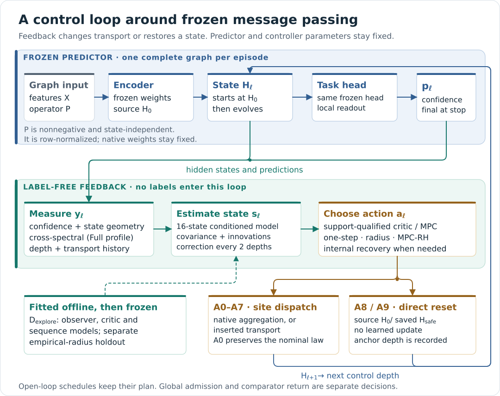

# CROSS-MORSE

**Inference-time control of message passing in frozen graph neural networks**

Abdolvahab Khalili Sadaghiani · Linköping University

[](https://github.com/VKHS/CR-9/actions/workflows/quality.yml)
[](STATEMENT_COMPLIANCE.md)
[Statement compliance](STATEMENT_COMPLIANCE.md) · [Final destination](docs/FINAL_DESTINATION.md) · [destination/](destination/README.md) · [One-command reconstruction](docs/RECONSTRUCTION.md) · [Regenerate on a cluster](docs/HPC.md) · [Reviewer guide](docs/REVIEWER_GUIDE.md) · [Reviewer FAQ](docs/REVIEWER_FAQ.md) · [Method](docs/METHOD.md) · [Analytical statements](docs/THEORY.md) · [Getting started](docs/GETTING_STARTED.md) · [Datasets](docs/DATASETS.md) · [Availability](AVAILABILITY.md) · [Paper support](paper/PAPER_SUPPORT.md) · [Reported results](paper/RESULTS.md) · [Claims ledger](paper/CLAIMS.md)

CROSS-MORSE attaches an external controller to a frozen graph predictor. At
inference, intermediate representations guide whether and how propagation
continues. Learned predictor weights remain fixed; open-loop schedules and
feedback policies are compared on the same predictor through a declared
selection, confirmation, and admission protocol.



## Every table and figure in one command

The repository combines experiment code, configurations, environment specifications
and generators with a verified publication workflow for the measured outputs.
The artifact inventory covers the paper's source data, executed split and seed
manifests, checkpoints, predictions, propensity-logged trajectories and statistical
outputs. The publication workflow uses the `paper-artifacts` release in
[GitHub Releases](https://github.com/VKHS/CR-9/releases), with published assets
listed by SHA-256 in [`release/paper_artifacts.json`](release/paper_artifacts.json).

```bash
git clone https://github.com/VKHS/CR-9.git && cd CR-9
make paper                     # download and verify the published outputs, rebuild all 90 displays, compare
make paper PAPER_TIER=complete # also the lifecycle checkpoints and full prediction arrays
make statement-check           # each item of the availability statement and where it is fulfilled
make printed-statement-check   # each claim of the availability text printed in the manuscript
make final-destination         # the repository after publication: design forecast, roles, release, close-out
```

`make paper` verifies the published artifacts and each run's sealed eight-stage
chain, writes the supported tables (CSV, Markdown, LaTeX) and figures (PNG, SVG)
with their source data, and places computed values beside independently registered
paper values (`displays/compare/`). It succeeds only when every required display,
value and comparison is complete and agrees at the printed precision.
[Statement compliance](STATEMENT_COMPLIANCE.md) states, item by
item, what is fulfilled and what awaits publication;
[Producing the measured outputs](docs/PRODUCTION.md) produces all of them on the
cluster with one command, and [Publishing the measured outputs](docs/PUBLICATION.md)
describes how they enter the release.

The final publication check is `make statement-fulfilled`. It verifies the complete
artifact tier, including checkpoint and prediction bytes, executes reconstruction,
and checks the committed source-data and manifest views against those artifacts.
`make availability-fulfilled` adds every claim of the longer availability text that the
manuscript prints (main text page 15, Methods, Supplementary Information page 30), which
[Statement compliance](STATEMENT_COMPLIANCE.md) evaluates claim by claim. The
[final destination](docs/FINAL_DESTINATION.md) draws the repository as it will stand after
publication from what the repository already fixes: the printed values that the released code
determines by design and their agreement with the paper, the pre-registered data roles, the
projected contents and size of every run archive, and the close-out sequence.
[`destination/`](destination/README.md) holds every file that publication writes into the
checkout, projected at the path it will occupy, with the twelve registered items evaluated on
them ([12 of 12 at the destination](destination/STATEMENT_COMPLIANCE.md)); after publication,
`make final-destination-converge` checks every realized file against its projection.
The [paper-reference guide](docs/PAPER_REFERENCE_VALUES.md) explains how printed
comparison targets are tied to the author's manuscript files.

Existing experiment folders can be checked before publication:

```bash
make paper-preflight PUBLISH_MAP=/abs/paper-artifacts.map.json PAPER_PREFLIGHT_ROOT=/abs/new-preflight
```

This verifies the local inputs and reconstructs the available displays without
uploading files or changing the release inventory. The [publication guide](docs/PUBLICATION.md)
explains the input map and the distinction between local readiness and public
availability. The [availability review](docs/AVAILABILITY_REVIEW.md) records the
implemented improvements and the evidence still needed for the full statement.

### CPU demonstration

A separately published demonstration runs the whole pipeline end to end on public data with
this repository's code on GitHub-hosted CPU runners: the seven lifecycle runs (Roman-empire on
its complete official graph, all ten splits; the other datasets on deterministic subsets of their
official data), the record sets and campaigns that the production graph derives from them, and
their checkpoints, predictions, propensity-logged trajectories, manifests, environment and
statistics, published as the release `demo-artifacts`.

```bash
make demo-paper                # download the demonstration release and rebuild every table and figure from it
```

The demonstration is not the paper's evidence: its values come from reduced-scale CPU runs, and
no status in [Statement compliance](STATEMENT_COMPLIANCE.md) depends on it.
[demo/README.md](demo/README.md) describes its scale and production, and
[demo/RESULTS.md](demo/RESULTS.md) what it contains.

## Regenerate the results on a Slurm cluster

Independently of the published outputs, the Slurm launcher executes the registered eight-stage lifecycle on all seven
datasets, including Roman-empire's ten official splits. Its report rebuilds
supported run-derived tables and compares the available quantities with the
paper. Auxiliary experiments use the drivers in [Experiments](docs/EXPERIMENTS.md).
The [artifact catalog](docs/ARTIFACT_CATALOG.md) identifies the code, data sources,
split and seed specifications, execution artifacts and their producing commands.

```bash
git clone https://github.com/VKHS/CR-9.git && cd CR-9
$EDITOR run_cross_morse.sh            # SITE SETTINGS: account, partition, GPU request, storage, modules
bash run_cross_morse.sh check         # settings, runtime identity and job plan; creates and submits nothing
bash run_cross_morse.sh reproduce     # setup, seven lifecycles, report
bash run_cross_morse.sh status        # progress
```

| | |
|---|---|
| Site settings | One block at the top of `run_cross_morse.sh`, preset to the authors' cluster (NAISS Arrhenius, one NVIDIA GH200 per job); or a profile selected with `CM_ENV_FILE`, which keeps the launcher byte-identical |
| Identity | `check` and `reproduce` verify the runtime fingerprint recorded in `release/release_scope.json`; every run seals it with its source snapshot, configuration, data-role membership, checkpoints and decision records |
| Resilience | Jobs that reach their time limit checkpoint at a safe boundary and requeue themselves; a GPU or driver failure requeues the job on another node; `reproduce resume` continues a suite |
| Report | `REPRODUCTION_REPORT.md` places each dataset's deployed policy and paired effect beside main Table 1, summarises the comparison of every readable quantity (exact, inside the printed 95% interval, or outside), embeds the rebuilt Tables 1–2 and records the GPU-hours used; a results ZIP holds every run's decision records |
| First run | `bash run_cross_morse.sh reproduce smoke` exercises the complete orchestration on synthetic data in minutes; `pilot` uses the official data with reduced compute |

The [HPC guide](docs/HPC.md) documents every setting, job, record and exit
code, and the compute the paper reports per dataset; the
[Arrhenius walkthrough](docs/ARRHENIUS_SESSION.md) is the authors' session.

## For reviewers

Without a GPU, check the software and replay the two bundled synthetic runs:

```bash
make review REVIEW_OFFLINE=1 REPORT_ROOT=../cm-reports
```

This writes `../cm-reports/review/REVIEW_REPORT.md` with the status of each
check and its output; the verdict `SOFTWARE-ONLY` means every software and
example check passed. The [reviewer guide](docs/REVIEWER_GUIDE.md) maps each
review concern to its code, commands and the records a reproduction produces;
the [reviewer FAQ](docs/REVIEWER_FAQ.md) answers the questions a reader of this
repository is likely to ask, each with the file that holds the fact and the
command that checks it. The [claim-to-evidence ledger](paper/CLAIMS.md) lists
all 34 manuscript table groups with their builders.
`make docker-review` provides the same entry point in a CPU container.

## Paper and supplementary results

This repository supports the completed experimental study **CROSS-MORSE:
Cross-Spectral Control of Message Passing in Frozen Graph Neural Networks**.
The exact identities of the 16-page paper and 38-page supplement, the protocol
constants, registered numerical results and complete numbered-display inventory
are recorded in `paper/`.

- [Reported results](paper/RESULTS.md) presents the seven-dataset loss, official-metric
  and cost results, including the distinction between an evaluated arm and the
  policy returned by the registered confirmation rule.
- [Complete paper support inventory](paper/PAPER_SUPPORT.md) maps all **90 numbered
  tables and figures** to source pages, numerical registries, implementation and
  reconstruction commands.
- [Manuscript review](paper/MANUSCRIPT_REVIEW.md) records the contextual review that
  binds the registry to the PDFs.

```bash
make paper-report-check    # document identities, complete display map and current reports
make verify                # implementation, reference arithmetic and sealed example checks
make compare RUN_ROOT=/abs/run REPORT_ROOT=/abs/reports   # one regenerated run beside the paper
```

### Build a traceable reconstruction workspace

```bash
make reconstruction-example REPORT_ROOT=../cm-reports
# With registered benchmark runs and auxiliary records:
make reconstruct RUNS_INDEX=/abs/runs/index.json RECORDS_INDEX=/abs/records/index.json \
  RECONSTRUCTION_ROOT=/abs/paper-build
```

One workspace contains the supported tables and plots, machine-readable source
data, input and software identities, an inventory of all 90 displays and hashes
for every output file. The report distinguishes full numerical tables, available
columns and partial figure panels. Optional confirmation and budget campaigns
add their validated supplementary analyses. See [Reconstruction](docs/RECONSTRUCTION.md)
and [Supplementary builders](docs/SUPPLEMENT_BUILD.md) for the input contracts and
the strict completeness check. Original benchmark artifacts and new executions
retain their own identities throughout this workflow.

Mathematical bounds, resampled uncertainty, fitted cost laws and analytical
sensitivities retain their scientific meaning in the paper; the registry
records which entries are measurements, derived arithmetic or analytical
sensitivities.

## Try the software

Use Python 3.12 on Linux. The recorded CPU environment installs PyTorch and the
dependencies needed for verification and a small synthetic run.

```bash
git clone --depth 1 https://github.com/VKHS/CR-9.git
cd CR-9
make env-cpu PYTHON=python3.12 VENV_DIR=../cm-cpu
source ../cm-cpu/bin/activate
make verify
make test
make reproduce REPORT_ROOT=../cm-reports
```

The repository includes two complete, sealed synthetic examples: **arxiv** for
transductive node classification and **Peptides** for independent-graph multilabel
prediction. They contain checkpoints, predictions, trajectories, and decision
records. `make reproduce` numerically replays those records; `make example-paper`
rebuilds their tables and figures. The examples are software demonstrations.

To execute a new small lifecycle with the current source:

```bash
make train-sample DATASET=Peptides-func RUN_ROOT=../cm-work/peptides-smoke DATA_ROOT=../cm-work/data
make replay RUN_ROOT=../cm-work/peptides-smoke REPORT_ROOT=../cm-reports
```

## Run an experiment

All seven dataset adapters and all 21 profiles are included. `smoke` uses
synthetic data, `pilot` uses official data with reduced computation, and `full`
uses the registered full execution budget and explicit model widths. The seven
full-profile parameter totals agree with Supplementary Table S5 at its printed
precision; the [parameter inventory](docs/DATASETS.md#model-parameter-inventory)
records their architecture settings and counting scope.
`make model-inventory` instantiates and counts them. Pilot and full runs may
download data and require substantial compute; see the
[dataset guide](docs/DATASETS.md) and the [HPC guide](docs/HPC.md).

| Dataset | Task | Entry point | Slurm wrapper |
|---|---|---|---|
| ogbn-arxiv | Node classification | `run_cross_morse_arxiv.py` | `run_cross_morse_arxiv.sh` |
| ogbn-products | Node classification | `run_cross_morse_products.py` | `run_cross_morse_products.sh` |
| ogbn-proteins | Multilabel node prediction | `run_cross_morse_proteins.py` | `run_cross_morse_proteins.sh` |
| Roman-empire | Node classification; ten official splits | `run_cross_morse_roman_empire.py` | `run_cross_morse_roman_empire.sh` |
| PascalVOC-SP | Node classification on independent graphs | `run_cross_morse_pascalvoc_sp.py` | `run_cross_morse_pascalvoc_sp.sh` |
| COCO-SP | Node classification on independent graphs | `run_cross_morse_coco_sp.py` | `run_cross_morse_coco_sp.sh` |
| Peptides-func | Multilabel graph prediction | `run_cross_morse_peptides_func.py` | `run_cross_morse_peptides_func.sh` |

For example, run an arxiv pilot on a CUDA device without Slurm:

```bash
python run_cross_morse_arxiv.py --profile pilot --device cuda \
  --data-root ../cm-data --output-dir ../cm-runs/arxiv-pilot
```

Training data are divided into fitting, exploration, selection, confirmation,
and comparison roles (60/20/10/5/5). Official validation is reserved for admission;
test labels are used after policy lock. Supported operators, statistical
assumptions, and the exact implemented variants are explained in the
[method guide](docs/METHOD.md).

## Release scope

<!-- availability:start -->
**Reproduction resources:** Experiment code, configurations, artifact verification and reconstruction commands are included. [Statement compliance](STATEMENT_COMPLIANCE.md) identifies the published files and the measured outputs awaiting publication. `make paper` verifies the [release artifacts](https://github.com/VKHS/CR-9/releases), rebuilds their displays and compares them with the paper; see [availability](AVAILABILITY.md).
<!-- availability:end -->

`make verify` checks the software package and bundled examples. A regenerated
run is checked with `make compare RUN_ROOT=...`, replayed numerically with
`make replay RUN_ROOT=...`, and packed for sharing with `make archive-run`; the
[archive guide](docs/RUN_ARCHIVES.md) covers packing, verification, ingestion
and the table builders. `make availability-statement` generates the
manuscript's availability paragraph from this release.
[REPRODUCIBILITY.md](REPRODUCIBILITY.md) maps the reproducibility checklist to
implementation files and to the records a reproduction produces, and the
[paper-support contract](docs/PAPER_SUPPORT.md) maps E1–E20 to the observations,
runtime checks and decisions that support each claim.

## Source and reference checks

`make registry-check` checks executable constants, analytical reference formulas
and arithmetic within the transcribed tables:

| Check | Inputs |
|---|---|
| Actions, sensor settings, thresholds, seeds, plant settings and controlled sites | Source literals and full-profile configurations against the protocol registry |
| Kernel coefficients, band sensitivities, sparse-to-dense ratio, sensing shares and estimates of nominal propagation work | Registered formulas, published dataset summaries, widths and depths |
| Cost ratios, sensing residuals, admissible sketch ratios, expected costs and cross-table results | Transcribed measurements and the formulas relating them |

`make theory` and `make si-check` are part of `make verify` and need only NumPy
and the Python standard library:

| Check | Inputs |
|---|---|
| Definitions 1–2, Lemmas 1–3, Propositions 1–11, Theorems 1–2 and Corollaries 1–2 on seeded random instances of their hypotheses | Reference implementations in `cm_theory/`, the executable action registry, `cross_morse.statistics` (Theorem 2) and `cm_experiments.budget` (Algorithm S3) |
| Holm family, margin and two-way rescaling of the mechanism tests, factorial effects, selection readings, ensemble law, power, retained-share, attribution, tail-cost and amortization entries | The transcribed supplementary tables and the formulas the supplement states for them |

[Analytical statements](docs/THEORY.md) maps every statement to its reference
implementation, runtime counterpart and checks. `make si-report` writes the
recomputed supplementary values with their notes to `REPORT_ROOT`.

`make model-inventory` separately constructs all seven full-profile models and
checks their actual parameter counts. These checks establish configuration and
arithmetic consistency; benchmark losses, metrics, timings and GPU-hours come
from executing the lifecycle, which `run_cross_morse.sh reproduce` does and
compares with the paper.

## Repository guide

| Location | Purpose |
|---|---|
| `run_cross_morse.sh`, `run_cross_morse_<dataset>.sh` | Reproduction launcher with the SITE SETTINGS block; dataset wrappers |
| `cross_morse/`, `run_cross_morse*.py` | Models, transport, sensing, policies, statistics, and the eight-stage lifecycle (the fingerprinted runtime) |
| `configs/` | Smoke, pilot and full profiles of every dataset; site-profile templates |
| `cm_experiments/`, `cm_campaigns/`, `hpc/` | Budget-matched arms, external-baseline harness, campaigns, and measurement capture |
| `cm_theory/` | Reference implementations and numerical verification of the analytical statements |
| `examples/` | Two complete synthetic runs and their replay outputs |
| `paper/` | Source metadata, numerical comparison targets, and result builders |
| `runs/`, `records/`, `manifests/` | Run and record indexes, record schemas, and split/seed specifications |
| `scripts/`, `tests/`, `environment/` | Reproduction support, verification, packaging, tests, and environment specifications |
| `docs/` | Guides for reproduction, method, experiments, archives, validation and review |
| `Dockerfile`, `environment/apptainer.def` | CPU containers using recorded Python package versions (`make docker-verify`, `make docker-review`) |

For the next step, use the [HPC guide](docs/HPC.md),
[experiment instructions](docs/EXPERIMENTS.md),
[archive and result reconstruction](docs/RUN_ARCHIVES.md), or
[validation commands](docs/VALIDATION.md). `make help` lists the common commands.

## Citation and license

Use [CITATION.cff](CITATION.cff) and identify the source commit used in an
experiment. The accompanying manuscript is under review. Software is licensed
under [BSD-3-Clause](LICENSE); manuscript and figure rights are described in
[NOTICE](NOTICE). Contributions should follow [CONTRIBUTING.md](CONTRIBUTING.md).
