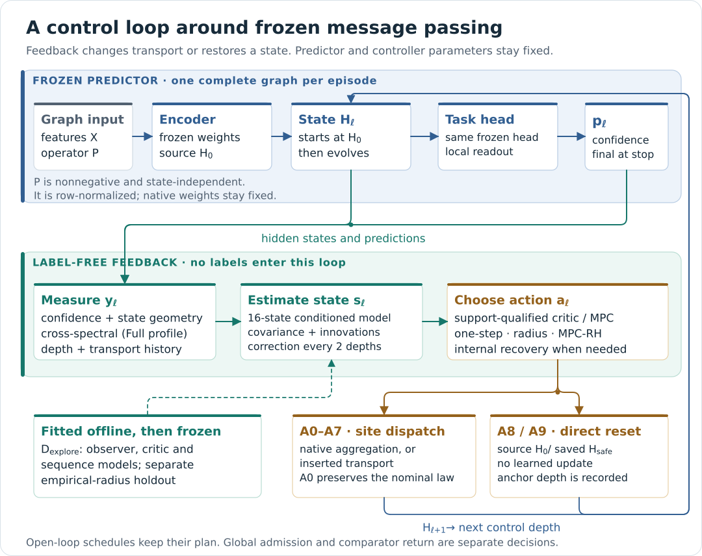
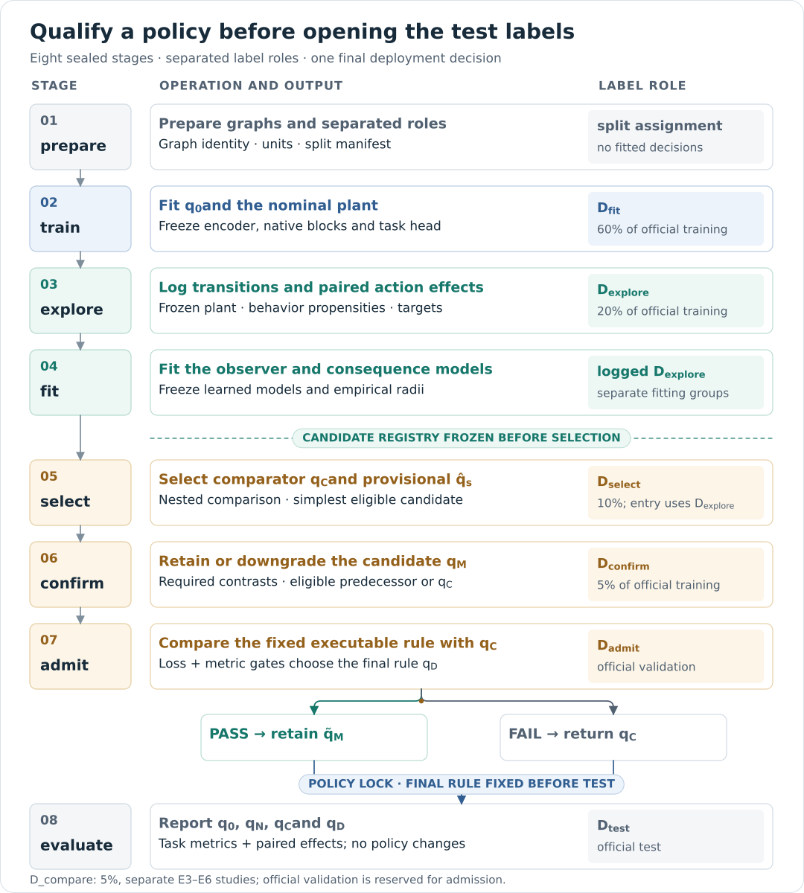

# Method and implementation

[Documentation](README.md) · [Datasets](DATASETS.md) · [Availability](../AVAILABILITY.md)

CROSS-MORSE controls message passing around a frozen graph predictor. It first
selects a strong open-loop propagation policy, then evaluates whether label-free
observations during propagation justify feedback. Encoder, native updates and
prediction head retain their trained parameters during controller execution.

## Supported interface

The controlled aggregation must expose intermediate representations and a
nonnegative, state-independent linear graph operator that can be row-normalized.
The released plants implement this interface explicitly. A controlled
state-dependent attention kernel and standard nonlinear GINE edge messages are
outside that interface. GPS-style global attention retains its own computation;
its activations may change when its incoming representations change.

| Plant family | Released use |
|---|---|
| Shared learned propagation update | arxiv and products |
| Nonnegative edge-weighted shared update | proteins |
| Separate ego and neighbor maps | Roman-empire |
| Local aggregation plus graph-local attention | PascalVOC-SP and COCO-SP |
| Linear aggregation with graph mean readout | Peptides-func |

The [seven-dataset parameter inventory](DATASETS.md#model-parameter-inventory)
lists the exact per-predictor counts, explicit internal widths, Table S5
comparison and compatibility with older configurations. Each run records its
actual model class, widths, parameter/buffer counts and optimization-active
counts in `train/model_inventory.json`; sealed architecture and checkpoint
identities identify the executed model. Native-site placement, graph weights and
precision are recorded with the actual configuration.

GPS and linear-GINE full profiles use frozen two-layer prediction heads;
dropout is disabled during inference. A Lipschitz readout bound for these heads
uses the spectral norms of both linear layers and the activation factor, with
graph mean pooling for Peptides. The supplement's single-matrix linear-head
specialization applies to the configurations with a linear head.

## What is fixed and what is fitted

The nominal predictor and an encoder/head reference are trained on `D_fit`, with
an internal checkpoint-validation subset. Predictor parameters then freeze.
Exploration on `D_explore` supplies transitions and paired counterfactual targets
for the observer, action critic, transition model, stage-cost model and
terminal-value model. Radius calibration and assessment use separate complete
groups within exploration. Policy configurations freeze before selection.

| Symbol | Meaning |
|---|---|
| `q0` | Separately trained encoder/head reference without propagation |
| `qN` | Frozen plant executing the nominal action to full registered depth |
| `qC` | Selected open-loop comparator |
| `qM` | Confirmed feedback candidate, when the confirmation requirements pass |
| `qD` | Retained executable policy, or the comparator after fallback |

The runtime performs no predictor-parameter updates. Labels are used in the
registered offline roles; action selection on an execution episode is label-free.

## Transport actions

For current node state `H`, encoded source `H0` and row-stochastic graph operator
`P`, local and resolvent actions change mixing and source retention around the
fixed native computation. The truncated resolvent is evaluated by sparse products:

$$
K_a H=\eta_a\sum_{t=0}^{T}(1-\eta_a)^tP^tH+(1-\eta_a)^{T+1}H.
$$

The identity term retains the omitted mass. The configured truncation order is
not the expected transported distance. No dense graph inverse is constructed.

| Action | Executed role |
|---|---|
| A0 | Nominal native block; literal identity at an inserted transport site |
| A1–A2 | Registered local mixing/retention alternatives |
| A3–A7 | Registered truncated-resolvent mixtures |
| A8 | Direct reset to `H0` |
| A9 | Direct reset to the saved last-safe representation |

A8/A9 bypass the learned update. The last-safe predicate uses finite,
label-free measurements; its name does not certify predictive correctness.
Native and inserted sites have distinct dispatch semantics. Full GPS-style
profiles use six native and 122 inserted sites; the Peptides profile uses eight
native and 56 inserted sites. Control depth therefore differs from learned-layer
count. Exact parameters are in [the registry](../paper/registered_constants.json)
and execution is in [`core.py`](../cross_morse/core.py).

## Feedback and policy family

At each controlled depth, the runtime measures representation/prediction features,
updates its observer, checks action support, chooses an action, and records the
executed action and work. Internal recovery handles invalid or unsupported
states; global rejection later returns `qC`.

The full sensor combines confidence, geometry, history, spectral power, source
alignment and transport-reach descriptors. The lean profile suppresses the
spectral/reach coordinates and fits its own controller. Sensor acquisition,
observer correction and action execution have separate cadences and costs.
Cached measurements are not displacement certificates.

The action critic predicts a paired action-versus-nominal continuation effect.
The radius route adds critic uncertainty, an independently fitted residual radius
and the configured transport penalty. MPC uses transition, stage-cost and
terminal-value models with bounded beam search. These are distinct estimands;
summing action-critic outputs does not itself prove a complete-policy effect.

| Policy | Information and timing |
|---|---|
| Nominal / best depth | Fixed nominal schedule or development-selected stopping depth |
| Learned stop | Initial measurements choose a stopping depth once |
| Phase schedule / fixed sequence | Complete action schedule fixed before execution |
| MPC-OL | Plan from the initial state; execute the fixed plan |
| One-step / radius | Choose using the current estimated state |
| MPC-RH | Replan from the current state and execute the first action |

Candidate profiles, horizons, coefficients and ensemble sizes form a finite
registered family. Support assessment uses logged propensities and complete
holdout groups. Insufficiently supported cells remain unsupported. The actual
support and decision records are part of each run.

## Data roles and decisions

Official training data are partitioned into **60/20/10/5/5** fitting, exploration,
selection, confirmation and independent comparison roles. Official validation is
reserved for admission. Test labels are read after the policy lock. On graph
collections, role membership and control episodes use complete graphs; runtime
work and feasibility are scoped to the current role.

The implementation selects the comparator and provisional candidate on registered
development data, applies the frozen confirmation requirements, then evaluates
the eligible candidate against `qC` on admission data. A failed confirmation or
admission returns the comparator. Passing a later numerical criterion cannot
repair an earlier failed gate.

The implementation's eligible selector family is feedback candidates plus `qC`.
Other open-loop rows remain diagnostic in the ledger. `Q_s`, the near-best band
and the selection guarantee must use that same family. The reference checker
also exposes an explicitly requested `all_feasible` diagnostic to examine the
manuscript's domain ambiguity; it does not change the runtime. The
[paper-support contract](PAPER_SUPPORT.md) records the reconciliation needed for
Eqs. (3), (18)–(19) and the S11 predecessor map.

Independent-graph admission bounds have conditional assumptions: independent
admission observations, the declared clipping/loss definition, and policy choices
fixed before admission. They concern expected clipped loss difference, not every
input or every official metric. Single-graph cores and overlapping Roman masks
remain dependent/descriptive units. Transport identities and conditional
statistical statements do not establish universal predictive improvement.

Each analytical statement has a reference implementation in `cm_theory/` and a
seeded numerical check that `make theory` runs; [Analytical statements](THEORY.md)
lists them with their scope. The checks test the stated implications on random
instances of their hypotheses; they do not test whether a trained backbone
satisfies those hypotheses.

## Source map

| Responsibility | Source |
|---|---|
| Backbone, graph operator, actions | [`cross_morse/core.py`](../cross_morse/core.py) |
| Dataset loading and task losses/metrics | [`datasets.py`](../cross_morse/datasets.py), [`tasks.py`](../cross_morse/tasks.py) |
| Predictor training | [`training.py`](../cross_morse/training.py) |
| Controller learning and calibration | [`learning.py`](../cross_morse/learning.py) |
| Policy rollout and recovery | [`policies.py`](../cross_morse/policies.py), [`recovery.py`](../cross_morse/recovery.py) |
| Role-scoped execution and lifecycle | [`runtime.py`](../cross_morse/runtime.py), [`pipeline.py`](../cross_morse/pipeline.py) |
| Budget-matched comparison studies | [`cm_experiments/`](../cm_experiments/) |
| Timing and campaign contracts | [`cm_campaigns/`](../cm_campaigns/) |
| Reference implementations of the analytical statements | [`cm_theory/`](../cm_theory/), mapped in [Analytical statements](THEORY.md) |
| Archives, comparisons and evidence checks | [`scripts/`](../scripts/), [`paper/build/`](../paper/build/) |

[Implementation notes](../paper/IMPLEMENTATION_NOTES.md) specify the remaining
configuration conventions. [Experiments](EXPERIMENTS.md) describes E3–E6 and their
executable scope.
